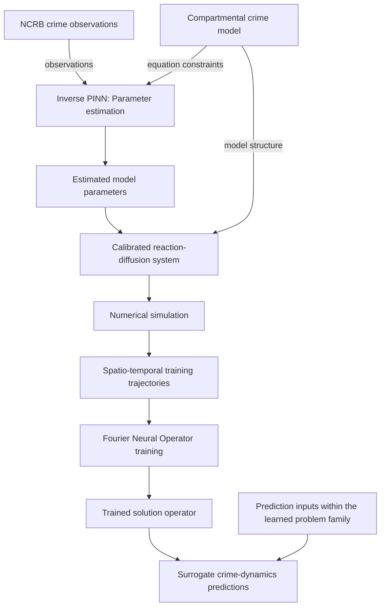

# Crime Dynamics Modeling with Inverse PINNs and Fourier Neural Operators

A hybrid scientific machine learning framework combining **Inverse Physics-Informed Neural Networks (PINNs)** and **Fourier Neural Operators (FNOs)** for modeling spatio-temporal crime dynamics using **National Crime Records Bureau (NCRB)** crime data.

The framework connects parameter estimation from observed data, numerical simulation of a calibrated reaction-diffusion model, and neural operator learning for fast surrogate prediction.

---

## 📌 Overview

Crime is a complex spatio-temporal phenomenon influenced by interactions between susceptible individuals, criminals, and prison populations. Mathematical compartmental models provide a framework for studying these interactions, while reaction-diffusion equations extend the model to describe evolution across space and time.

Two computational challenges motivate this work:

- **Parameter estimation:** Determine unknown model parameters from observed crime data while respecting the governing equations.
- **Repeated simulation:** Predict spatio-temporal trajectories efficiently when numerical simulation must be performed repeatedly.

This repository presents a hybrid workflow:

1. An **Inverse PINN** estimates unknown compartmental model parameters using NCRB crime data and the governing model equations.
2. A **numerical reaction-diffusion solver** uses the estimated parameters to generate spatio-temporal trajectories.
3. An **FNO** learns the solution operator from the generated simulation dataset and serves as a surrogate for subsequent prediction.

---

## 🏗️ Architecture

The diagram shows the conceptual workflow described by the project, from observed crime data to surrogate prediction.

### Component Responsibilities

| Component | Role | Output |
| :--- | :--- | :--- |
| NCRB crime data | Provide observations for inverse parameter estimation. | Observed crime measurements. |
| Compartmental model | Describe interactions between susceptible individuals, criminals, and prison populations. | Governing model equations. |
| Inverse PINN | Estimate unknown parameters using observations and physics constraints. | Estimated model parameters. |
| Reaction-diffusion system | Describe spatio-temporal dynamics using the calibrated model. | PDE problem for numerical simulation. |
| Numerical solver | Generate solutions of the calibrated reaction-diffusion system. | Spatio-temporal trajectories. |
| Fourier Neural Operator | Learn the solution operator from simulated trajectories. | Trained surrogate model. |
| Surrogate prediction | Apply the trained operator to compatible prediction inputs. | Predicted spatio-temporal evolution. |

---

## 🔬 Methodology

### 1. Estimate Parameters with an Inverse PINN

Use NCRB crime observations to estimate unknown parameters of the compartmental crime model.

The inverse learning process combines two sources of information:

- **Observed data:** Encourage agreement between model predictions and recorded crime measurements.
- **Governing equations:** Constrain the learned dynamics to follow the mathematical model.

**Output:** Estimated parameters for model calibration.

### 2. Generate Spatio-Temporal Simulations

Insert the estimated parameters into the reaction-diffusion system and solve it numerically to generate trajectories across space and time.

These simulations form the dataset used for neural operator training.

**Output:** A dataset of numerical spatio-temporal solutions.

### 3. Train the Fourier Neural Operator

Train an FNO on the generated simulation dataset to learn the underlying PDE solution operator.

The FNO learns a mapping between the selected problem inputs and their corresponding solution fields. The exact input representation and predicted fields depend on the implementation and dataset construction.

**Output:** A trained neural operator for the modeled problem family.

### 4. Predict with the Trained Surrogate

Use the trained FNO to predict crime evolution for compatible inputs within the learned problem family.

The objective is to reduce the cost of repeated prediction after the initial parameter estimation, simulation, and training stages.

**Output:** Surrogate predictions of spatio-temporal crime dynamics.

---

## 🔄 Data Flow

| Stage | Input | Processing | Output |
| :--- | :--- | :--- | :--- |
| Parameter estimation | NCRB observations and compartmental equations. | Inverse PINN optimization. | Estimated parameters. |
| Model calibration | Estimated parameters and reaction-diffusion model. | Configure the governing PDE system. | Calibrated simulation problem. |
| Dataset generation | Calibrated PDE problem. | Numerical simulation. | Spatio-temporal solution trajectories. |
| Operator learning | Simulation input-solution pairs. | FNO training. | Learned solution operator. |
| Prediction | Trained FNO and compatible problem inputs. | Surrogate inference. | Predicted solution fields. |

The Inverse PINN performs parameter discovery; the FNO learns from the resulting simulations to support repeated prediction.

---

## ✨ Key Contributions

- **Physics-informed parameter estimation:** Combine NCRB crime observations with mathematical constraints to estimate unknown model parameters.
- **Spatio-temporal crime modeling:** Use reaction-diffusion equations to describe evolution across space and time.
- **Simulation-based operator learning:** Train an FNO on numerical trajectories generated by the calibrated model.
- **Unified modeling workflow:** Connect observed data, parameter discovery, numerical simulation, and surrogate prediction.
- **Computational efficiency objective:** Reduce the cost of repeated prediction through a trained neural operator.

---

## 🎯 Repository Goal

The objective of this work is to bridge mathematical crime modeling and scientific machine learning by combining PINNs and neural operators into a unified framework for understanding and forecasting spatio-temporal crime dynamics.

The framework uses observed data to calibrate the mathematical model and numerical simulations to train a reusable surrogate for prediction.
