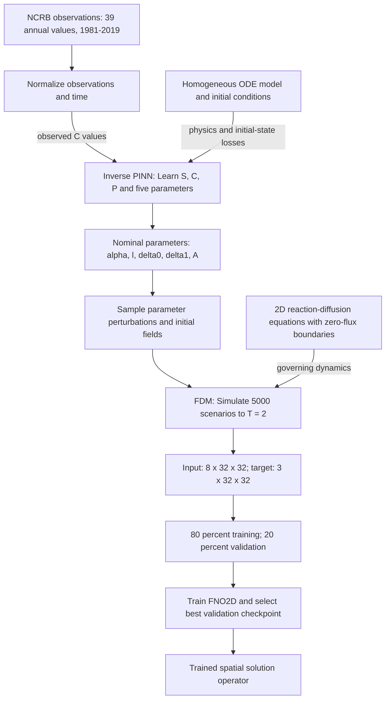
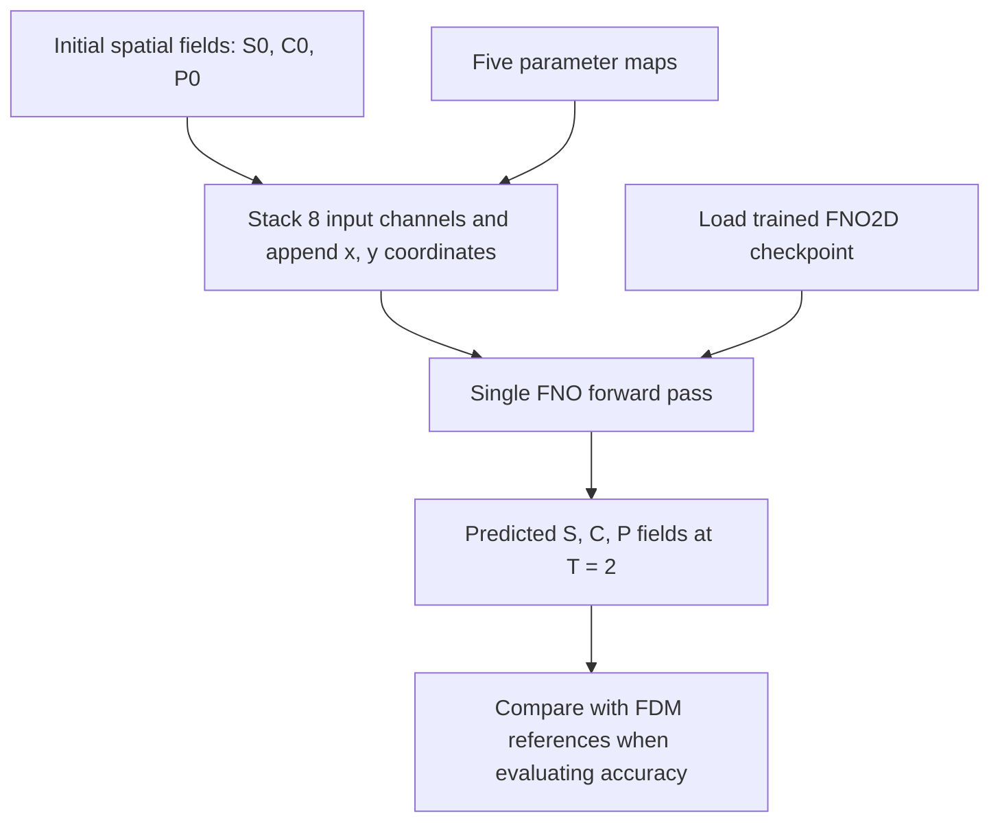
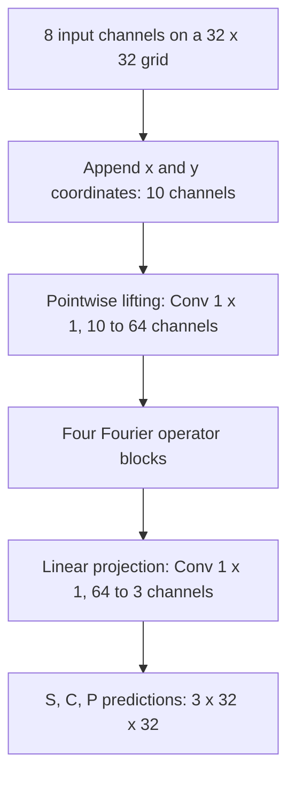
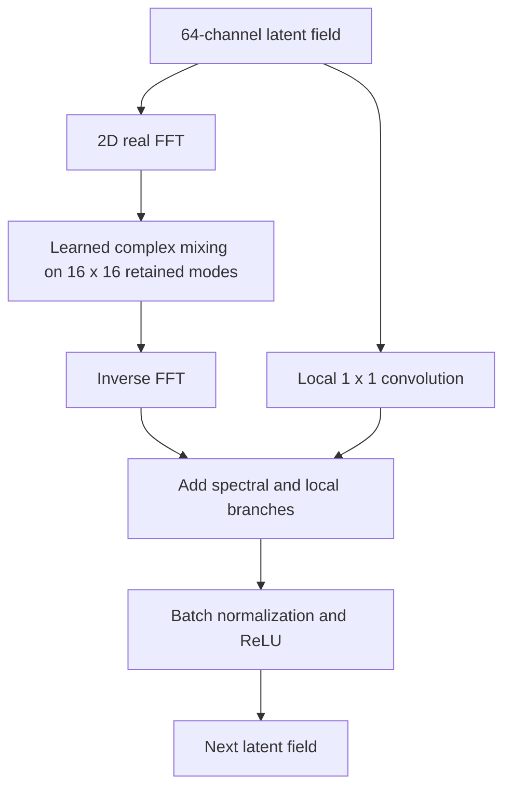

# Crime Dynamics Modeling with Inverse PINNs and Fourier Neural Operators


A scientific machine learning framework connecting **NCRB crime observations**, **inverse parameter estimation**, **reaction-diffusion simulations**, and **Fourier Neural Operator learning**.

[Repository](https://github.com/HarshitPranjal/Crime-Dynamics-using-PINN-FNO)

---

## 📌 What the Project Does

The project connects two learning tasks through a numerical solver:

| Stage | Question it answers | Method | Output |
| :--- | :--- | :--- | :--- |
| 1. Parameter discovery | Which model parameters can explain the observed temporal crime trend? | Inverse PINN with ODE constraints | Five estimated parameters |
| 2. Simulation | How does the calibrated model evolve across a two-dimensional region? | Finite Difference Method (FDM) | Synthetic spatial solution pairs |
| 3. Operator learning | Can a neural network reproduce the simulated final fields directly? | FNO2D | A reusable spatial surrogate |

**The central connection:** the PINN estimates parameters, the FDM solver generates training examples around those estimates, and the FNO learns from those examples.

The inverse PINN uses **39 annual NCRB observations from 1981–2019**. Only the criminal population proxy is observed directly. The FNO is trained on **simulated fields**, with the reported configuration mapping initial conditions and parameters to the three population fields at **fixed model time T = 2.0**.

---

## 🏗️ End-to-End Architecture

### Offline Training and Calibration



### Prediction After Training



Numerical simulation supplies training targets and evaluation references. After training, the surrogate produces a final spatial field without performing the corresponding time-stepping solve for each prediction.

---

## 🧮 1. Mathematical Crime Model

### State Variables

For a spatial point `(x, y)` and time `t`:

| Symbol | Meaning |
| :--- | :--- |
| `S(x, y, t)` | Susceptible or noncriminal population density |
| `C(x, y, t)` | Active criminal population density |
| `P(x, y, t)` | Prison population density |

These are mathematical compartments. The model describes population-level dynamics.

### Governing Reaction-Diffusion Equations

The population densities evolve according to:

```text
∂S/∂t = λ₁ ΔS + A − αSC + δ₁P − δ₀S
∂C/∂t = λ₂ ΔC + αSC − lC − δ₀C
∂P/∂t = λ₃ ΔP + lC − δ₁P − δ₀P
```

The two-dimensional Laplacian is:

```text
Δu = ∂²u/∂x² + ∂²u/∂y²
```

**Reaction** terms describe transfers, recruitment, and removal within the model. **Diffusion** terms describe spatial redistribution.

| Parameter or term | Interpretation in the equations |
| :--- | :--- |
| `A` | Recruitment into the susceptible compartment |
| `αSC` | Transfer from susceptible to criminal population through interaction |
| `lC` | Transfer from criminal to prison population |
| `δ₁P` | Return from prison to susceptible population |
| `δ₀` | Common removal rate from the three compartments |
| `λ₁, λ₂, λ₃` | Spatial diffusion coefficients |

### Boundary and Initial Conditions

The spatial domain uses homogeneous Neumann, or **zero-flux**, boundary conditions:

```text
∂S/∂n = ∂C/∂n = ∂P/∂n = 0    on the boundary ∂Ω
```

This prevents transport across the domain boundary. Recruitment and removal still change the total population inside the domain.

Initial fields satisfy:

```text
S(x, y, 0) = S₀(x, y) ≥ 0
C(x, y, 0) = C₀(x, y) ≥ 0
P(x, y, 0) = P₀(x, y) ≥ 0
```

### Population Balance and Crime Threshold

For the integrated population:

```text
N(t) = ∫_Ω [S(x, y, t) + C(x, y, t) + P(x, y, t)] dx dy

dN/dt = A · area(Ω) − δ₀N
```

The criminal generation number is:

```text
C_g = (Aα) / [δ₀(δ₀ + l)]
```

The crime-free equilibrium is:

```text
E₀ = (A/δ₀, 0, 0)
```

The model analysis identifies stability of the crime-free equilibrium for `C_g < 1` and a positive crime-persistence equilibrium for `C_g > 1`. This threshold describes the mathematical model, rather than an independently validated real-world policy rule.

---

## 🧠 2. Inverse PINN: Learn Parameters from NCRB Data

### Why the PINN Uses an ODE

The observations are annual temporal measurements, rather than spatially resolved fields. For parameter estimation, parameter estimation assumes spatial homogeneity and uses the corresponding ODE system:

```text
dS/dt = A − αSC + δ₁P − δ₀S
dC/dt = αSC − lC − δ₀C
dP/dt = lC − δ₁P − δ₀P
```

The homogeneity assumption matters: zero-flux boundaries alone remove integrated diffusion, but do not generally replace the spatial average of a product `SC` with the product of the averaged fields.

### Network Architecture

The network receives normalized time and predicts all three normalized states:

```text
N_w: ℝ → ℝ³

(S_hat(t), C_hat(t), P_hat(t)) = sigmoid(N_w(t))

sigmoid(z) = 1 / (1 + exp(−z))
```

| Setting | Configuration |
| :--- | :--- |
| Input | Normalized time in [0, 1] |
| Hidden layers | 4 fully connected layers, 64 neurons each |
| Hidden activation | Tanh |
| Output | 3 states with sigmoid activation |
| Initialization | Xavier normal weights; zero biases |
| Trainable physics parameters | alpha, l, delta0, delta1, A |
| Parameter constraint | Sigmoid transformation of each raw scalar |

To distinguish network weights from physical parameters, this README uses `w` for network weights and `θ_k` for a physical parameter:

```text
θ_k = sigmoid(θ_k_raw)
θ_k ∈ {α, l, δ₀, δ₁, A}
```

The raw physics parameters start at zero, giving initial transformed values of 0.5.

### Physics Residuals

The suffix `_hat` denotes a network prediction, for example `C_hat(t)` for the predicted criminal population.

Automatic differentiation supplies the time derivatives. The residuals are:

```text
R_S = dS_hat/dt − A + α S_hat C_hat − δ₁ P_hat + δ₀ S_hat
R_C = dC_hat/dt − α S_hat C_hat + l C_hat + δ₀ C_hat
R_P = dP_hat/dt − l C_hat + δ₁ P_hat + δ₀ P_hat
```

At 5,000 collocation times:

```text
L_ODE = (1/N_f) ∑_{i=1}^{N_f} [R_S(t_f⁽ⁱ⁾)² + R_C(t_f⁽ⁱ⁾)² + R_P(t_f⁽ⁱ⁾)²]

N_f = 5000
```

### Observation and Initial-State Losses

For the 39 min-max-normalized NCRB observations `c_i`:

```text
L_data = (1/N_d) ∑_{i=1}^{N_d} [C_hat(t_i) − c_i]²

N_d = 39
```

Only `C` enters this observation loss. The other two states are inferred through the equations and initial-state constraints.

The prescribed initial state is `(S(0), C(0), P(0)) = (0.95, c₀, 0)`:

```text
L_IC = [S_hat(0) − 0.95]² + [C_hat(0) − c₀]² + P_hat(0)²
```

The full objective is:

```text
L_total = L_ODE + 100 L_data + 100 L_IC
```

These are weighted penalty terms. The data and initial conditions are encouraged through optimization; multiplying their losses by 100 does not enforce exact equality. A sigmoid output can approach the prescribed zero prisoner state but cannot attain zero with finite logits.

### Training and Estimated Parameters

Parameter estimation uses full-batch Adam with learning rate `0.001` for **15,000 epochs**, optimizing the network weights and physical parameters jointly.

**Estimated model parameters:**

| Parameter | Estimated value |
| :--- | ---: |
| alpha | 0.999080 |
| l | 0.001070 |
| delta0 | 0.001096 |
| delta1 | 0.541510 |
| A | 0.343118 |

These are **effective dimensionless parameters** under the normalized states and time scale. They should not be interpreted directly as annual physical transition rates.

---

## 🌐 3. FDM: Build the Spatial Training Dataset

### Simulation Configuration

| Setting | Configuration |
| :--- | :--- |
| Domain | Unit square [0, 1] x [0, 1] |
| Grid | 32 x 32 |
| Spatial spacing | dx = dy = 1/31 |
| Final model time | T = 2.0 |
| Time step | dt = 0.001 |
| Time integration | Explicit forward Euler |
| Spatial derivatives | Second-order central differences |
| Boundary condition | Zero-flux Neumann |
| Diffusion | lambda1 = lambda2 = lambda3 = 0.01 |
| Dataset size | 5,000 simulations |
| Split | 80% training / 20% validation; seed 42 |

Each simulation independently perturbs the five nominal parameters:

```text
θ_k = θ_k* · ξ_k
ξ_k ~ Uniform(0.9, 1.1)
θ_k ∈ {α, l, δ₀, δ₁, A}
```

This exposes the FNO to a local parameter ensemble around the PINN estimates. The sampling rule represents a chosen perturbation range, rather than an estimated statistical confidence interval.

### Randomized Initial Fields

The susceptible field is uniform, and the prisoner field starts at zero:

```text
S₀(x, y) = s₀,    s₀ ~ Uniform(0.8, 1.0)
P₀(x, y) = 0
```

The criminal field starts as a Gaussian hotspot:

```text
C₀(x, y) = A_c · exp(−[(x − x₀)² + (y − y₀)²] / [2σ_c²])
```

| Quantity | Sampling range |
| :--- | :--- |
| Hotspot center x0, y0 | Independently uniform over [0.2, 0.8] |
| Hotspot width sigma_c | Uniform over [0.03, 0.12] |
| Hotspot amplitude A_c | Uniform over [0.1, 0.4] |

### Numerical Update

The forward-Euler and central-difference scheme can be written compactly as follows. For `u ∈ {S, C, P}` and its reaction term `f_u`:

```text
u[i,j,n+1] = u[i,j,n] + Δt · [λ_u · Δ_h(uⁿ)[i,j]
                              + f_u(S[i,j,n], C[i,j,n], P[i,j,n])]
```

```text
Δ_h(u)[i,j] = (u[i+1,j] − 2u[i,j] + u[i−1,j]) / Δx²
              + (u[i,j+1] − 2u[i,j] + u[i,j−1]) / Δy²
```

The boundary discretization must implement the stated zero-flux condition. The expressions above describe the interior stencil.

### What One Training Sample Contains

```text
a = [S₀, C₀, P₀, α·1, l·1, δ₀·1, δ₁·1, A·1]
shape(a) = (8, 32, 32)

u_T = [S(·, T), C(·, T), P(·, T)]
shape(u_T) = (3, 32, 32)
```

Each parameter is broadcast to a constant spatial map. The FNO training target is the **final snapshot at T = 2**, even though the solver evolves the system through intermediate times.

---

## ⚡ 4. FNO2D: Learn the Fixed-Horizon Solution Operator

### Operator Mapping

```text
G†: (S₀, C₀, P₀, α, l, δ₀, δ₁, A)
    → (S(·, T), C(·, T), P(·, T))

T = 2.0
```

The trained approximation `G_φ` predicts these fields from one input configuration. Time is fixed in this reported mapping; an arbitrary-time rollout is not part of the specified FNO input-output design.

### Network Architecture



### Inside Each Fourier Block



Writing `a_aug = [a, g_x, g_y]` for the coordinate-augmented input:

```text
v₀ = Lift(a_aug)
Lift: ℝ¹⁰ → ℝ⁶⁴
```

Each of the four operator blocks is:

```text
spectral_ℓ = IFFT2(W_ℓ · FFT2(v_ℓ))
local_ℓ    = W_ℓ_local(v_ℓ)

v_(ℓ+1) = ReLU(BN(spectral_ℓ + local_ℓ))

ℓ = 0, 1, 2, 3
```

The Fourier branch captures spatial correlations through retained spectral modes. The local branch provides pointwise channel mixing. The output projection is:

```text
u_hat_T = Project(v₄)
Project: ℝ⁶⁴ → ℝ³
```

The FNO uses a linear output head with **no output activation**. Unlike the PINN's sigmoid outputs, the FNO predictions therefore have no built-in nonnegativity constraint.

### Training Objective and Configuration

The FNO minimizes relative L2 error against FDM reference fields. The notation `‖v‖₂` means the Euclidean norm of the flattened field values:

```text
L_FNO(φ) = ‖G_φ(a) − u_T‖₂ / ‖u_T‖₂
```

| Setting | Configuration |
| :--- | :--- |
| Fourier blocks | 4 |
| Latent width | 64 |
| Retained Fourier modes | 16 x 16 |
| Optimizer | Adam |
| Initial learning rate | 0.001 |
| Weight decay | 0.000001 |
| Batch size | 8 |
| Epochs | 75 |
| Scheduler | StepLR; halve learning rate every 25 epochs |
| Checkpoint selection | Lowest validation relative L2 loss |

The FNO training objective is supervised by numerical solutions. The explicit physics-residual loss belongs to the inverse PINN stage.

---

## 📊 Benchmark Results

The following benchmark values describe the documented experimental configurations.

| Reported configuration | RMSE | Relative L2 error | Inference time (s) |
| :--- | ---: | ---: | ---: |
| 5,000 samples; 75 epochs | 0.00268 | 0.00304 | 0.103 |
| 1,400 samples; 25 epochs | 0.0108 | 0.0124 | 0.0626 |
| 500 samples; 15 epochs | 0.028265 | 0.033033 | 0.086848 |

Evaluation focuses on the criminal population field against FDM reference solutions. RMSE and relative L2 error can be written as:

```text
RMSE = sqrt((1/M) ∑_{j=1}^{M} [u_hat_j − u_j]²)

Relative L2 = ‖u_hat − u‖₂ / ‖u‖₂
```

The largest configuration achieves approximately **0.304% relative L2 error** for the largest configuration. This measures agreement with numerical model outputs, rather than direct validation of real-world spatial crime forecasts.

The documented dataset split is 80% training and 20% validation. A separate test partition is not specified here; evaluation partitions should be recorded explicitly when reproducing the results.

Inference times are listed for the FNO. A speedup factor requires matching FDM timings on the same hardware under the same measurement procedure.

---

## 🔄 How the Pieces Fit Together

| Step | What you provide | What is learned or computed | What moves to the next stage |
| :--- | :--- | :--- | :--- |
| 1. Normalize | 39 NCRB annual observations | Normalized crime values and observation times | Temporal training data |
| 2. Fit inverse model | Temporal data, ODEs, initial state | Three state trajectories and five effective parameters | Nominal parameter estimates |
| 3. Sample scenarios | Nominal estimates and initialization ranges | Parameter perturbations and Gaussian hotspot fields | Spatial PDE inputs |
| 4. Solve PDEs | Spatial inputs and zero-flux boundaries | FDM solutions up to T = 2 | Input/final-field pairs |
| 5. Train operator | 8-channel inputs and 3-channel targets | FNO weights selected by validation loss | Trained checkpoint |
| 6. Predict | Compatible initial fields and parameters | One-pass final-field prediction | S, C, P maps at T = 2 |
| 7. Evaluate | Predictions and FDM references | Field errors and inference timing | Surrogate quality measurements |

**Example:** choose a Gaussian initial crime hotspot, a uniform susceptible field, zero initial prisoners, and five parameters near the PINN estimates. The FDM solver produces the reference fields by time stepping to T = 2. The trained FNO takes the corresponding eight input maps and approximates those final fields directly.

---

## 📌 Model Scope

The spatial grid and final time are model coordinates. The normalized temporal fit does not establish a geographic calibration or a calendar-year interpretation of the FNO horizon. A solution at finite time T = 2 is a final-time snapshot; reaching steady state requires a separate convergence check.
